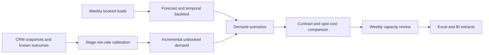

# Freight capacity planning

How much capacity should a planner reserve before the next week starts? Reserving
too much wastes contracted capacity. Reserving too little exposes the operation to
spot prices and service shortfalls. This project combines booked-load forecasting,
CRM opportunity weighting and a costed capacity decision.


## Run it

Python 3.10 or newer. The analysis uses the standard library and needs no credentials.

```bash
python -m unittest discover -s tests -v
python run.py
```

Open `build/index.html`. The pipeline exports weekly demand, lane-level backtests,
forecast intervals, CRM weighting and the capacity plan. A downloadable
[sample report](sample/index.html) and [Excel scenario model](excel/capacity-plan.xlsx)
are included.

## What was measured

| Measure | Result on synthetic data |
|---|---:|
| Lanes | 6 |
| Training / held-out weeks | 104 / 12 |
| Held-out forecast WAPE | 5.72% |
| Coverage of the nominal 90% residual band | 79.17% |
| Expected weekly scenario cost | $508,718.33 |
| Cost difference versus reserving rounded mean demand | $3,999.16 |

The seasonal trend model beats both simple baselines on five lanes. On L06, a
late demand shift makes seasonal naive slightly better. The interval undercovers,
especially after that shift. These failures are part of the result and are retained
in `sample/backtest_scores.csv` and `sample/forecast_detail.csv`.

The cost difference is a model comparison on the same residual scenarios, not realized
business savings. Rates, demand and customer opportunities are all illustrative.

## Method



The forecast uses an intercept, linear trend and annual sine/cosine terms. A last-four-week
mean and seasonal naive forecast provide honest baselines on the same horizon.
Calibration residuals use only prior observations. The test period is not used in
the training fit. After evaluation, the next-week plan is fit using all observed weeks.

CRM stage probabilities use historical outcomes known by the cutoff with a Beta(2,2)
prior. Only unbooked open opportunities add demand. SQL keeps future outcomes out of
calibration. The `crm.py` adapter is GET-only and has mocked pagination tests. Live
CRM extraction and tenant-specific field mapping have not been validated.

The capacity search evaluates every whole-load contract allocation up to maximum
scenario demand. It pays reserved capacity in full, limits spot supply to 25 loads
per lane, and applies a shortfall penalty. This is a small planning model, not a
network-routing optimizer.

## Review the work

- [Forecasting and cost model](planning.py)
- [CRM calibration SQL](sql/crm_pipeline.sql)
- [Model assumptions and limitations](docs/method.md)
- [Power BI and Tableau calculations](bi/README.md)
- [Weekly planning workflow](integrations/README.md)
- [Development workflow](docs/development.md)

## Excel model

The workbook lets a planner change demand, reservations and unit costs. Its cost is
for the entered deterministic demand, so it differs from the scenario-average metric
above. Input sensitivity, formulas and rendering were checked during authoring.
Native Excel refresh through Power Automate remains a tenant acceptance check.
No employer records, private application details or commercial rates are included.
