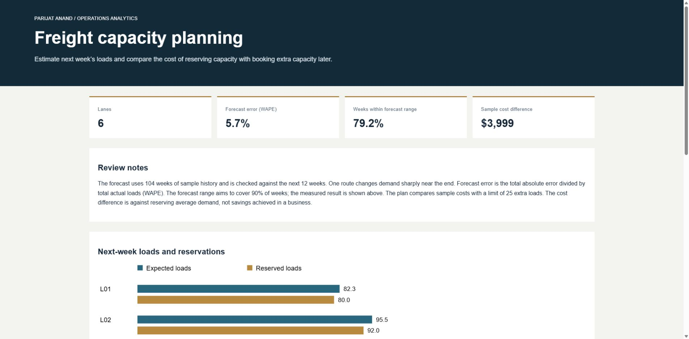
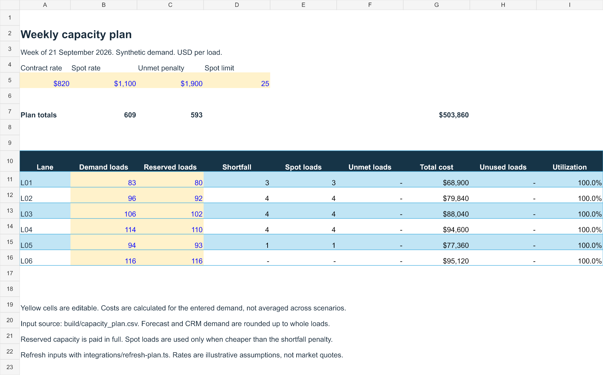

# Freight demand and capacity planning

Helps a planner compare how much freight capacity to reserve for the coming week.

Reserving too much leaves paid capacity unused. Reserving too little means buying extra capacity or leaving loads uncovered. This project compares those costs using past demand and possible new work.



[Open the sample report](https://parijat9.github.io/reports/capacity.html) · [Download the Excel model](excel/capacity-plan.xlsx)

## What it does

- Estimates weekly demand for six routes.
- Checks the estimates against weeks that were not used to build the forecast.
- Adds possible new work from sample sales opportunities.
- Compares reserved capacity, extra capacity and uncovered loads.
- Lets a planner change the assumptions in Excel.

## Try it

Use Python 3.10 or newer. The example needs no extra packages or account access.

```bash
python -m unittest discover -s tests -v
python run.py
```

Open `build/index.html`. The run also saves CSV files containing the forecasts, checks and capacity choices.

## How it works

1. Use past weekly shipments to look for trends and seasonal changes.
2. Compare the forecast with two simpler ways of estimating demand.
3. Include sales opportunities that have not already been booked.
4. Compare the cost of different capacity choices.
5. Save a weekly plan for review.

## What the sample results mean

The example uses made-up records: 104 weeks to build the forecast and 12 later weeks to check it. Across six routes, total absolute forecast error was 5.72% of total actual demand.

The forecast beat both simpler methods on five routes, but not on the sixth. Its expected range captured about 79% of the checked values, below the intended 90%. That means the range was too narrow and needs improvement.

The cost comparison is a planning example, not a claim of actual savings. Demand, rates and sales opportunities are all sample inputs.

## Excel planning sheet



Change demand, reserved loads and unit costs to see the effect on the plan. The sheet calculates costs for the demand you enter; the browser report averages several possible demand outcomes, so the totals can differ.

## More detail

- [Forecast assumptions](docs/method.md)
- [Power BI and Tableau setup](bi/README.md)
- [Weekly planning steps](integrations/README.md)
- [Forecast and cost calculations](planning.py)

The Zoho CRM connection only reads records. It has been checked with sample responses, but has not been tested with a live CRM account. The BI files are starting queries and calculations, not finished Power BI or Tableau reports.
